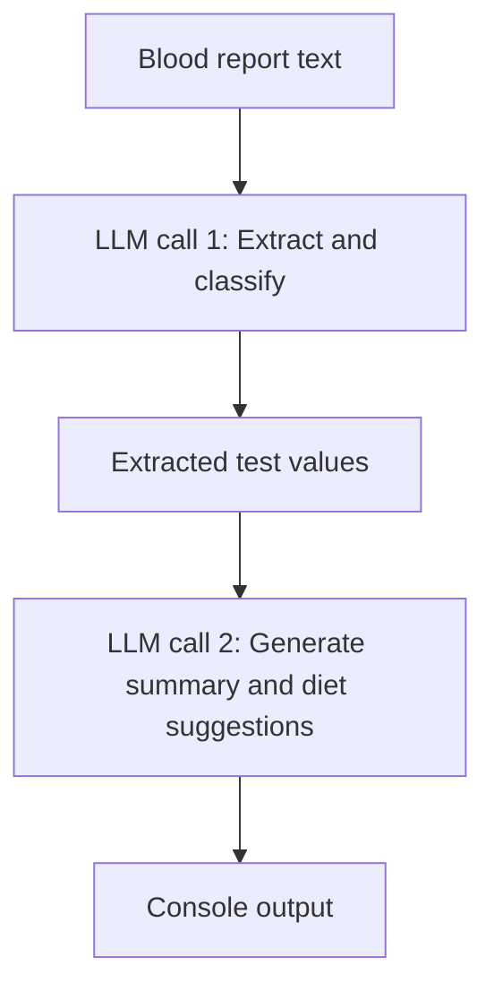

# Blood Analysis AI

A small Python application that reads a blood report, extracts test results, and generates a plain-language summary with practical Indian diet suggestions using LangChain and Google's model API.

## How it works



The two stages reuse the same model instance. The screenshot's “LLM 1” and “LLM 2” represent separate calls; they do not require different models. This is sequential prompt chaining, with stage 1 output becoming stage 2 input.

- **Stage 1:** Extracts test names, values, units, and reference ranges. Requests HIGH, LOW, or NORMAL classifications based on the report's ranges, or UNKNOWN when classification is not supported.
- **Stage 2:** Requests a 3–4-line summary and a diet plan containing only **Foods to avoid** and **Foods to eat more of**.

## Tech stack

Python 3.10+, `python-dotenv`, `langchain-google-genai`, and a Google API key with access to the configured model.

## Project structure

```text
blood-analysis-ai/
├── main.py
├── blood_work.txt       # Add your own report locally
├── .env                 # Local credentials and model configuration
├── requirements.txt
├── .gitignore
└── README.md
```

The downloaded source files do not include a patient report or real credentials.

## Setup and run

1. Open a terminal in the project folder and create a virtual environment:

   ```bash
   python -m venv .venv
   ```

2. Activate it:

   ```bash
   # Linux / macOS
   source .venv/bin/activate

   # Windows PowerShell
   .venv\Scripts\Activate.ps1
   ```

3. Install dependencies:

   ```bash
   pip install -r requirements.txt
   ```

4. Create `.env` next to `main.py`:

   ```dotenv
   GOOGLE_API_KEY=your_google_api_key
   GOOGLE_MODEL=your_available_google_model_id
   ```

   Choose a model ID available to your Google API account. The source preserves the original `gemma-4-31b-it` default, but its availability has not been verified. Set `GOOGLE_MODEL` explicitly to override it.

5. Create `blood_work.txt` next to `main.py`, containing plain-text test names, values, units, and reference ranges. PDF and image parsing are not implemented.

6. Run:

   ```bash
   python main.py
   ```

Report and `.env` paths are resolved relative to the script, so running it from another directory still works.

## Output

```text
=== STAGE 1: EXTRACTED VALUES ===
[Extracted test values, statuses, and reference ranges]

=== STAGE 2: HEALTH SUMMARY & DIET PLAN ===
[Short summary]

Foods to avoid
[Suggestions]

Foods to eat more of
[Suggestions]
```

A successful run makes two sequential API calls. Results are printed to the terminal rather than saved to a file.

## Code organization

| Function | Responsibility |
| --- | --- |
| `read_report()` | Load and validate the input text |
| `extract_values()` | Run the extraction prompt |
| `generate_diet_plan()` | Run the summary and diet prompt |
| `print_section()` | Format console output |
| `main()` | Load configuration and coordinate both stages |

Prompts and paths are defined once, and the main guard prevents API calls when the module is imported. Missing credentials, missing or empty reports, and empty model responses produce errors; API exceptions propagate for troubleshooting.

## Limitations and responsible use

This is an educational prototype, not a diagnostic or clinical nutrition system. Blood results alone cannot establish a patient's condition or determine an individualized diet. Model classifications and suggestions may be incorrect, and stage 1 errors can propagate into stage 2. Review the original report and generated output with a qualified clinician.

Output formatting and classifications are requested through prompts, not enforced by a schema or deterministic range checks. Report delimiters help distinguish data from instructions but do not guarantee protection from prompt injection. Future improvements include structured extraction, validated numeric comparisons, and human review before generating dietary guidance.

Report contents are sent to the configured Google service. Use synthetic or appropriately de-identified reports for demonstrations. Keep API keys and patient reports out of version control. The included `.gitignore` excludes local credentials, virtual environments, and `blood_work.txt`.

## Validation

Python syntax was checked locally. Live API calls and end-to-end model behavior were not tested; no credentials or patient report were supplied. Dependencies are unpinned; pin versions after validating the application in your environment.

## References

- [LangChain Google integration](https://docs.langchain.com/oss/python/integrations/chat/google_generative_ai)
- [Google API key setup](https://ai.google.dev/gemini-api/docs/api-key)
